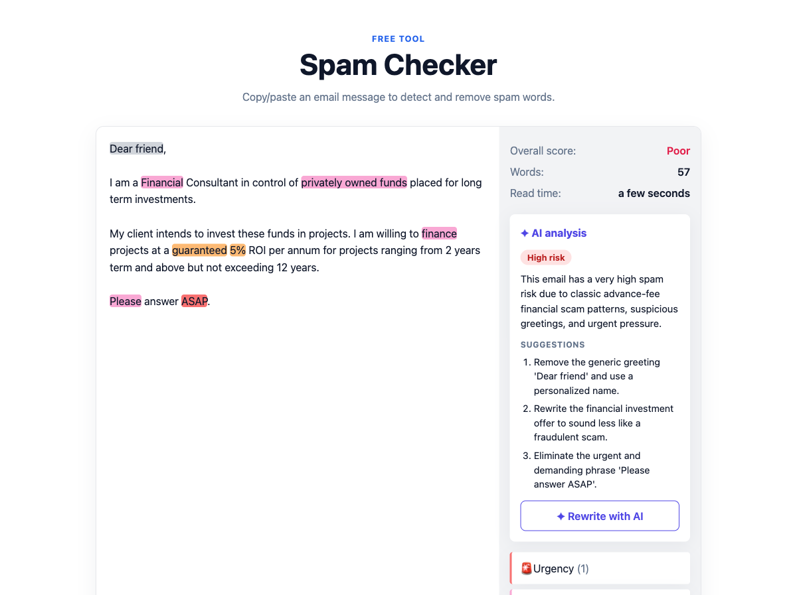

# Spam Checker + AI analysis

A Vue rebuild of a spam-word checker for emails, with an **AI analysis** card: a summary, a risk level, 3 suggestions, and a one-click **Rewrite with AI**. It's backed by an Express API that returns structured, validated LLM output and is rate limited against abuse.



- **Live highlighting** of 769 spam words in 5 categories, with the original tool's score, word count and read time.
- **✦ AI analysis**, on click: a summary, a low/medium/high risk badge and exactly 3 actionable suggestions, in the email's language. Editing the text marks the result as outdated.
- **✦ Rewrite with AI** applies the 3 suggestions to the email. **Undo** brings back the original, byte for byte.

## Architecture

```
                ┌──────────────────────── one Docker image, one origin ────────────────────────┐
browser ──────▶ │ Express 5                                                                     │
  Vue 3 SPA     │  helmet                                                                       │
  (static)      │  GET  /api/health                                                             │
                │  POST /api/analyze ─┐  per-IP limits → json (20kb) → validateBody(zod)        │
                │  POST /api/rewrite ─┘  → global caps → llmRoute ─▶ Analyzer ─▶ AI SDK ─▶ LLM  │
                │  static client/dist + SPA fallback                                            │
                └───────────────────────────────────────────────────────────────────────────────┘

shared/   zod schemas + types: the API contract, used by the server, the LLM call and the client
server/   config, prompts, Analyzer (port) + LLM adapter, HTTP layer, rate limits
client/   spam-word engine, highlighting editor, score, AI card (composables + components)
```

- **One contract** (`shared/`): the same zod schema validates requests, forces the LLM's JSON shape, and validates responses in the client.
- **`Analyzer` port:** the HTTP layer depends on an interface. Tests inject a fake; `main.ts` wires the real model.
- **Provider-agnostic:** the [Vercel AI SDK](https://ai-sdk.dev) with structured output. Gemini is the default.

## API

### `POST /api/analyze`

```bash
curl -s localhost:3000/api/analyze -H 'content-type: application/json' \
  -d '{"text":"Dear friend, guaranteed 5% ROI, answer ASAP"}'
```

```json
{
  "summary": "This email has an extremely high risk of landing in the spam folder due to classic spam trigger words, aggressive urgency, and a generic salutation.",
  "riskLevel": "high",
  "suggestions": [
    "Replace the generic greeting 'Dear friend' with a personalized name.",
    "Remove spam trigger phrases like 'guaranteed 5% ROI' and 'ASAP'.",
    "Add more contextual body text and a clear physical business address."
  ]
}
```

- **Request:** `text` is 1 to 5,000 characters after trimming.
- **Response:** `summary` is at most 400 characters; `riskLevel` is `low`, `medium` or `high`; `suggestions` is exactly 3 strings of at most 120 characters each.

### `POST /api/rewrite`

- **Request:** `{ "text": "...", "suggestions": ["...", "...", "..."] }`.
- **Response:** `{ "rewrittenText": "..." }`, at most 5,000 characters, so the rewrite can be analyzed again.
- It shares the rate-limit budget with `/api/analyze`.

### Errors

Every error has the same shape, `{ "error": { "code": "...", "message": "..." } }`. The client reads the **code**, never the message.

| Condition                                        | Status              | Code                |
| ------------------------------------------------ | ------------------- | ------------------- |
| Invalid input (schema, not JSON)                 | 400                 | `INVALID_INPUT`     |
| Unknown `/api` route                             | 404                 | `NOT_FOUND`         |
| Body over 20kb                                   | 413                 | `PAYLOAD_TOO_LARGE` |
| Per-IP limit                                     | 429 + `Retry-After` | `RATE_LIMITED`      |
| Global per-minute cap                            | 503 + `Retry-After` | `LLM_UNAVAILABLE`   |
| Provider error, including the provider's own 429 | 503                 | `LLM_UNAVAILABLE`   |
| Global daily cap                                 | 503 + `Retry-After` | `DAILY_CAP_REACHED` |
| LLM answer doesn't match the schema              | 502                 | `LLM_BAD_OUTPUT`    |
| LLM timeout (15 s)                               | 504                 | `LLM_TIMEOUT`       |
| Anything else (details are logged, never sent)   | 500                 | `INTERNAL`          |

A 429 means "_you_, slow down". When the shared quota is the problem, the answer is a 503, never a 429.

## Rate limiting

The routes are public, so every request spends a shared LLM quota. Gemini's free tier is 15 requests per minute and 500 per day per Cloud project.

| Limiter            | Default | Counts                           | Answer |
| ------------------ | ------- | -------------------------------- | ------ |
| Per IP, per minute | 5       | every request, junk included     | 429    |
| Per IP, per day    | 20      | every request, junk included     | 429    |
| Global, per minute | 12      | only requests that reach the LLM | 503    |
| Global, per day    | 400     | only requests that reach the LLM | 503    |

- **Per-IP limits run before body parsing,** so malformed or oversized requests still count and probing isn't free.
- **Global caps run after validation,** so junk can't drain the shared quota. They sit below Google's limits (15/min, 500/day), so our 503 comes before Google's 429. A quota 429 from Google is never retried. A 5xx or network error is retried once, which can cost one extra upstream request: the caps leave headroom (3/min, 100/day) for that.
- **Analyze and rewrite share** one bucket per IP and the global caps.
- **`trust proxy = 1`:** on Coolify, Traefik sits in front of Express and appends the real client address **last** in `X-Forwarded-For`. Trusting exactly one hop makes `req.ip` that address.
  - With `false`, every visitor would share Traefik's IP and one limit.
  - With `true`, a client could forge the header and get a fresh budget on every request.

  A test sends forged `X-Forwarded-For` headers to prove this. Set `TRUST_PROXY=0` when nothing sits in front.

- **Single instance:** counters live in memory. Running several replicas would need a shared store, such as `rate-limit-redis`, which is a one-line change per limiter.

All values are environment variables (see [`.env.example`](.env.example)).

## Switching LLM provider

```bash
LLM_PROVIDER=google      LLM_MODEL=gemini-3.5-flash-lite  GOOGLE_GENERATIVE_AI_API_KEY=...
LLM_PROVIDER=openai      LLM_MODEL=...                    OPENAI_API_KEY=...
LLM_PROVIDER=anthropic   LLM_MODEL=...                    ANTHROPIC_API_KEY=...
```

`server/src/llm/model.ts` is the only file that names providers. The prompts, the schema and the error handling don't change.

## Local development

Requirements: Node 24 (`.nvmrc`) and npm 11.

```bash
npm ci
cp .env.example .env        # then set GOOGLE_GENERATIVE_AI_API_KEY
npm run dev                 # shared (watch) + API on :3000 + client on :5173 (proxies /api)
```

Open http://localhost:5173. Without an API key, everything works except the AI card, which shows a clean "unavailable" error.

## Tests

```bash
npm test          # all workspaces
npm run lint      # ESLint + Prettier
npm run typecheck # tsc / vue-tsc
```

There are **223 tests**: Vitest for `shared` and `client`, Jest + Supertest for `server`.

- **Server:**
  - the LLM layer runs on the AI SDK's mock model, with no network;
  - every error code;
  - prompt injection (`</email>` in the text, injected suggestions);
  - `X-Forwarded-For` spoofing;
  - the shared budget across routes;
  - a client disconnect aborting the LLM call.
- **Client:**
  - the spam engine against the original tool's sample;
  - XSS in the editor (`` stays text);
  - out-of-order responses (only the latest analysis is applied);
  - byte-exact Undo;
  - every card state, including the `Retry-After` countdown.

Key behaviours were also checked by **mutation**: break the code on purpose, and the tests must fail.

CI (GitHub Actions) runs lint, typecheck and tests on Node 24, then builds the Docker image and smoke-tests it.

## Deploy (Coolify)

1. **New resource:** this GitHub repository, with the **Dockerfile** build pack.
2. **Port:** `3000`. The image has a `HEALTHCHECK` on `/api/health`.
3. **HTTPS:** give the resource an `https://` domain, so Traefik gets a Let's Encrypt certificate, and turn on HTTP → HTTPS redirection. Over plain HTTP the page stays **blank**: helmet's default CSP (`upgrade-insecure-requests`) makes the browser fetch the JS and CSS over HTTPS, which fails without a valid certificate. Coolify's auto-generated `sslip.io` address is plain HTTP, so don't demo on it.
4. **Environment:** the variables from `.env.example`, at least `GOOGLE_GENERATIVE_AI_API_KEY`. Keep `TRUST_PROXY=1` behind Coolify's Traefik.
5. **Check:** after deploying, 6 quick analyses from one machine must get a 429 on the 6th. If every visitor shares one limit, or nobody is ever limited, `TRUST_PROXY` doesn't match the number of proxies.

The image is multi-stage (`node:24-alpine`). The runtime stage holds only the server's production dependencies and the built client (about 200 MB), runs as the `node` user, and shuts down gracefully on `SIGTERM`.

## Data usage

The demo uses the Gemini API **free tier**. On that tier, Google may use the prompts (the email text) to improve its products. Don't paste confidential emails into the demo. The AI card says the same to visitors, under the Analyze button. A paid tier, or another provider, removes this caveat.

## Key decisions

Every non-obvious choice is in [`docs/DECISIONS.md`](docs/DECISIONS.md), with its context, alternatives and consequences. Read these first:

- **D2:** Vercel AI SDK + zod structured output (provider-agnostic, testable with a mock model).
- **D6:** four rate limiters, and where each one runs.
- **D7:** `trust proxy = 1` behind Traefik.
- **D10:** prompt-injection mitigation.
- **D11:** the error contract.

## What I'd do next

- **A Redis store** for the rate limiters, to run more than one instance.
- **Streaming** the analysis, so the summary appears word by word.
- **End-to-end tests** (Playwright) in CI, against the built image.
- **`zod/mini`** in the client, to cut about 25 kB gzipped.
